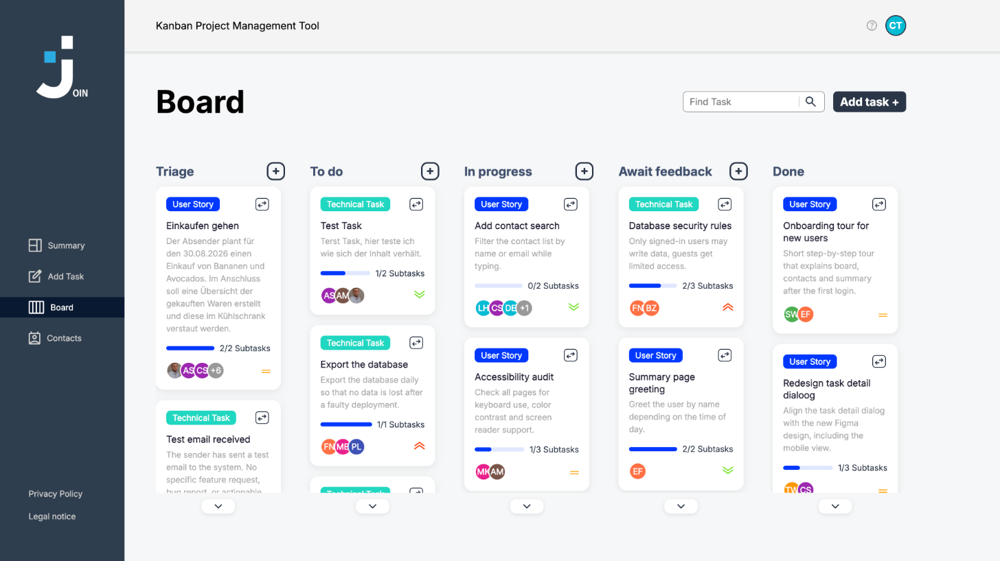
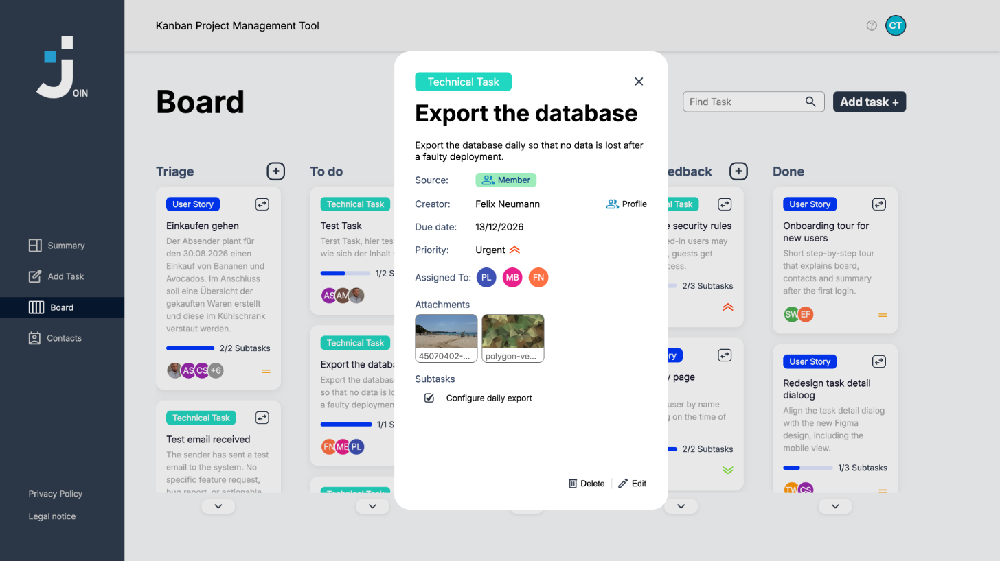
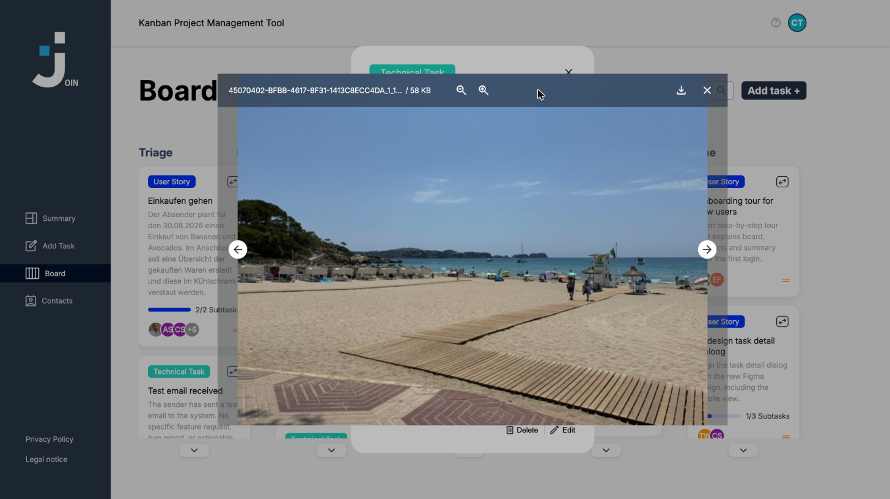
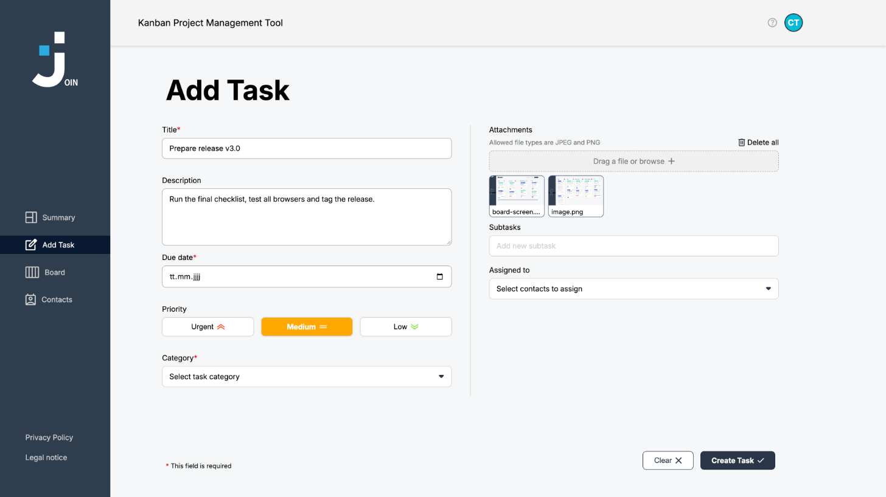
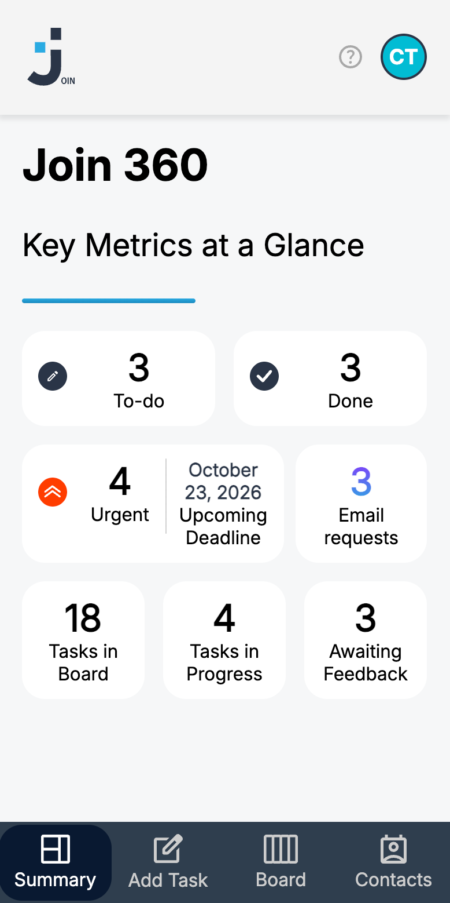
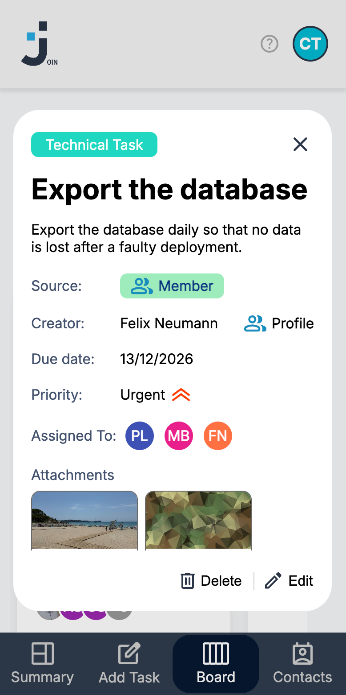

# Join – Issue Collector

Join is a vanilla JavaScript/HTML/CSS Kanban board (login, board with drag & drop, contacts, task details, summary dashboard) built on Firebase (Realtime Database + Authentication).

This repository extends the existing board with an **AI-powered issue collector**: stakeholders submit feature requests and bug reports by email, an n8n workflow analyzes the email content with Google Gemini, classifies and prioritizes it, and creates the ticket automatically in a dedicated "Triage" column on the board — with a clear, demoable AI logic end to end.

On top of that, tasks can carry **image attachments** (file upload with automatic compression, preview, image viewer and download), and contacts and the own account can have a **profile photo**.

**Live demo:** [join.christopher-braun-dev.de](https://join.christopher-braun-dev.de) (currently v2.0, v3.0 will follow after the project review)

> **Status:** complete. Base Kanban board, stakeholder landing page, and the full email/AI pipeline (n8n workflow, Triage column, daily throttling, error handling, status-change notifications) are all implemented and tested end to end.

## Screenshots

**Board** – Kanban board with the Triage column for AI-generated tickets



**Task detail** – ticket with source, creator, priority and image attachments



**Image viewer** – file name and size, paging, zoom and download



**Add Task with file upload** – drop zone and preview of the compressed images



**Mobile** – summary and task detail on a smartphone

<p>
  
  
</p>

## Versions

- `v1.0` – the accepted project state (classic scripts).
- `v2.0` – full refactor with the same behavior: ES modules, BEM CSS, all known bugs fixed, complete JSDoc.
- `v2.0.1` – bugfixes: board scrolling, task dialog, toast position, iPhone layout.
- `v3.0` – file upload for tasks (IHK exam task), contact photos, "My account", accessibility and responsive pass.

## Tech Stack

- Vanilla JavaScript (native ES modules), HTML5, CSS3 — no frameworks, no build step
- Firebase Realtime Database & Authentication
- n8n for the email-to-ticket automation (IMAP trigger, Google Gemini for classification, SMTP for notifications)

## Getting Started (Demo Usage)

### 1. Firebase project

The app needs its own Firebase project (Realtime Database + Authentication).

1. Copy `js/services/firebaseAuth.example.js` to `js/services/firebaseAuth.js`.
2. Fill in your Firebase project's config values (Firebase Console → Project Settings → General → Your apps).
3. Under **Authentication → Sign-in method**, enable both **Anonymous** (used for guest/board access and by the n8n workflow) and **Email/Password** (used by `index.html`'s signup/login) — both must be turned on explicitly, neither is enabled by default on a fresh Firebase project.
4. Set the Realtime Database rules so `contacts`, `tasks` and `users/$uid` require `auth != null` (see the rules already used in this project's Firebase console for the exact shape). Additionally add a narrowly-scoped public-read rule for `emailRequestCount/$date` (used by `stakeholder.html` to show the daily counter without exposing the full `tasks` tree).
5. Add `.validate` rules for the images: every entry in `tasks/$taskId/attachments` must have `name`, `type` (`image/jpeg` or `image/png`), `size` and a `base64` string that starts with the matching `data:image/...;base64,` prefix and stays below the size limit; `contacts/$contactId/photo` must be a JPEG/PNG data URL string as well.

`js/services/firebaseAuth.js` is gitignored — it is never committed, so every developer/demo instance uses its own project.

### 2. Run locally

The app uses native ES modules (`<script type="module">`), which browsers only load over `http://`, not via `file://`. Serve the folder with any static file server, for example:

```bash
python3 -m http.server 8000
```

or the VS Code "Live Server" extension. Then open `http://localhost:8000/welcome.html` (or `index.html` directly for the login/signup screen).

### 3. Demo data

No demo data is shipped with the repository. Create an account via "Sign up" (or use "Guest Log in"), then add contacts on the Contacts page and tasks via "Add Task" or the board.

### 4. n8n email pipeline

The two workflows are exported at `n8n/issue-collector-workflow.json` and `n8n/status-change-notifications-workflow.json`.

1. Run n8n (e.g. via Docker: `docker run -d --name n8n -p 5678:5678 -v n8n_data:/home/node/.n8n docker.n8n.io/n8nio/n8n`) and open it at `http://localhost:5678`.
2. Import both workflow files (Workflows → Import from File).
3. In both imported workflows, replace `YOUR_FIREBASE_API_KEY` in the "Sign In Anonymously" node URL(s) with your Firebase project's Web API key (Firebase Console → Project Settings → General → Web API Key).
4. Set up three credentials in n8n and assign them to the matching nodes:
   - **IMAP** — the dedicated inbox that receives stakeholder emails (used by "Email Trigger (IMAP)" and the "MoveEmail..." nodes, which need the `n8n-nodes-imap` community node installed).
   - **SMTP** — for sending confirmation/limit/error/status-update emails.
   - **Google Gemini (PaLM) API** — for the "Google Gemini Chat Model" node that classifies incoming emails.
5. Publish both workflows.

Once set up, sending an email to the configured inbox creates a ticket in the board's "Triage" column within seconds (subject/body → AI-classified category, title, priority, deadline), moves the email to the "erledigt" IMAP folder, and sends the sender a confirmation email. Errors or a reached daily limit (10 emails/day) route to the "zu bearbeiten" folder with a distinct notice email instead.

## Demo Flow

1. Open `welcome.html` — choose "Create request" (stakeholder) or "Member log in" (login/signup via `index.html`).
2. As a stakeholder: `stakeholder.html` shows the submission email address and the live daily-request counter, with a "limit reached" state once 10 requests have come in for the day.
3. Send a test email to the configured inbox — watch it appear as a new ticket in the board's Triage column, tagged "✨ Ai-generated ticket" with an "🌐 Extern" creator badge and the sender's name/email.
4. Move the ticket to another column — the original sender gets a status-update email (handled by the separate "Status Change Notifications" workflow, polling every 5 minutes).

## File Upload

- **Where:** "Attachments" field in Add Task (page and board dialog) and in the edit dialog of a task. Files can be chosen with the file picker (keyboard accessible) or dropped onto the drop zone; several files at once.
- **Allowed formats:** JPEG and PNG only — enforced by the picker's `accept` attribute, by JavaScript (`validateImageFile`) and by the Firebase rules. Wrong formats show a clear error message.
- **Compression:** every image is drawn onto a canvas and scaled so that width and height are at most **800 px** (`compressImage` in `js/utils/imageFiles.js`), then exported as JPEG/PNG data URL.
- **Limit:** each image must be **below 1 MB after compression**; otherwise the user gets an error and the image is not added.
- **Storage:** the images are saved with the task as an array `attachments: [{ name, type, size, base64 }]` in the Realtime Database (no separate file storage).
- **Preview:** thumbnails with file name in Add Task, the edit dialog and the task detail view; single images or all images can be removed before saving.
- **Image viewer:** opens on click (or Enter) on a thumbnail; shows file name and size, supports paging (buttons and arrow keys), zoom, download and closes with ✕, Esc or a click next to it.
- **Download:** directly from the thumbnails in the task detail view and from the viewer.
- **Profile photos:** contacts and the own account ("My account" in the user menu) can get a photo the same way (compressed to 200 px); it replaces the initials everywhere in the app.

## Architecture

- **One entry module per page** (e.g. `js/pages/board/boardPage.js`), loaded with a single `<script type="module">` tag. Each entry module has an `init()` that runs on `DOMContentLoaded`.
- **Event delegation** with `data-action` attributes instead of inline handlers (`onclick` etc.); DOM access via `querySelector` only.
- **Templates** (HTML strings) live in `js/templates/`, separate from the logic.
- **CSS in BEM** with native nesting. `css/layout.css` is loaded first, then each page links only the stylesheets it needs. Font sizes are CSS variables (`--fs-xs` … `--fs-8xl`) in `css/standard.css`.
- Clean-code rules: max. 14 lines per function (templates excluded), max. 400 lines per file, English everywhere.

## Project Structure

- `welcome.html`, `stakeholder.html` – public stakeholder-facing landing pages (role selection, feature-request submission info)
- `index.html` – login & signup
- `summary.html`, `addtask.html`, `board.html`, `contacts.html` – the app pages (dashboard, task creation, Kanban board with drag & drop, contact management)
- `legal.html`, `privacy.html`, `help.html` – legal notice, privacy policy, help
- `js/pages/` – one folder per page with its entry module and page logic (`board/` is split into data, rendering, drag & drop, move overlay, task dialog and edit dialog)
- `js/components/` – shared building blocks: layout (topbar, sidebar), task form, subtasks, attachments (file upload), contact form and photo, account dialog, validation, toast, confirm dialog
- `js/services/` – Firebase setup (`firebaseAuth.js`), auth (`authService.js`), route guarding (`authGuard.js`) and a thin Realtime Database wrapper (`database.js`: `loadData`/`putData`/`updateData`/`deleteData`)
- `js/templates/` – HTML template functions per area
- `js/utils/` – small helpers (formatting, IDs, avatar colors and photos, image reading/compression, validators, constants)
- `css/` – stylesheets per page and component (max. 400 lines each), e.g. `board.css`, `taskCard.css`, `taskDialog.css`, `dropdown.css`, `attachments.css`, `contactDialog.css`, plus shared `layout.css`, `standard.css`, `assets.css`, `fonts.css`
- `n8n/` – exported n8n workflow JSON (email pipeline + status-change notifications)
- `docs/` – JSDoc-generated API documentation, open `docs/index.html` in a browser to browse it

## License

See [LICENCE](LICENCE).
